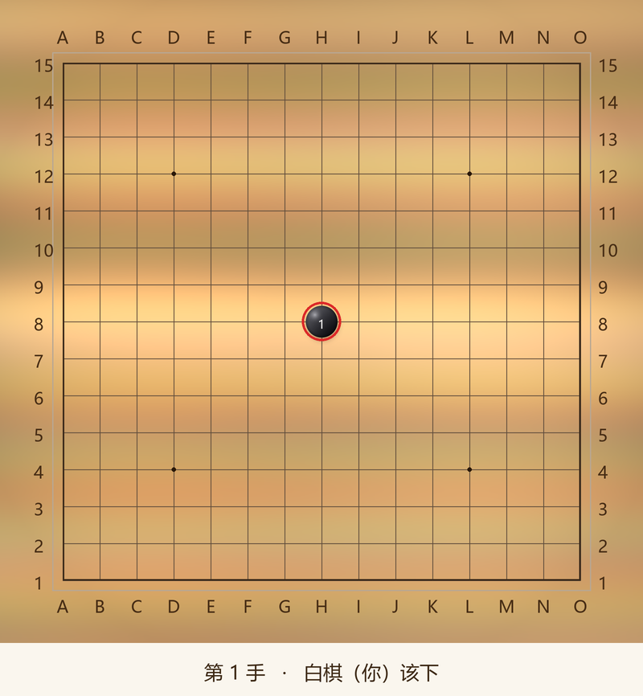

# 五子棋 · 15×15

一个完全离线的五子棋网页版，单文件、无依赖、不联网，双击 `play.html` 就能玩。



## 快速开始

双击 `play.html`，用任意现代浏览器打开即可。

或者：

```bash
python -m http.server 8000
# 然后访问 http://localhost:8000/play.html
```

## 功能

### 对局模式

| 功能 | 说明 |
|---|---|
| **人机对战** | AI 执黑或执白、先手颜色可换、三档强度（0.5 / 1.5 / 3.5 秒） |
| **双人对战** | 关闭 AI，两人轮流点击落子 |
| **摆棋模式** | 手动摆出任意局面，再让 AI 接着下（类似围棋复盘） |

### 规则选项

| 功能 | 说明 |
|---|---|
| **禁手规则** | 黑棋禁止三三、四四、长连（连珠规则） |
| **让子模式** | 让子方开局连下两子，可指定让给谁 |
| **AI 降档** | AI 先手时自动降低搜索深度、关闭算杀 |

### 操作

- 点击棋盘落子，悬停预览落点
- **悔棋**（`Ctrl+Z`）撤销上一回合
- **重新开始**（`R`）清空重开
- **复制棋谱** 导出完整走子记录
- 自动存档到浏览器 localStorage
- 手机触屏适配

## AI 是怎么工作的

**纯本地传统搜索算法，不调用任何大模型，不联网。**

| 组件 | 说明 |
|---|---|
| 搜索 | Alpha-Beta 剪枝 + 迭代加深 + 置换表（Zobrist 哈希） |
| 排序 | 杀手着法 + 历史启发 + 棋形增量评分 |
| 评估 | 5 格窗口增量评估 + 基于连子的棋形打分 |
| 算杀 | VCF（连续冲四取胜）搜索 |
| 禁手 | 连珠禁手判定（长连 / 四四 / 三三） |

安静局面约能搜索 10 层，具体取决于时间预算。

## 项目结构

```
├── play.html                单文件成品（引擎已内联）
├── board.png / board.html   命令行模式生成的棋盘
├── engine/
│   ├── gomoku.js            搜索与评估引擎
│   ├── forbidden.js         禁手判定
│   ├── game.js              命令行对局管理
│   └── test_*.js            测试
└── tools/
    ├── play_template.html   界面模板
    ├── build_play.py        把引擎内联进模板，生成 play.html
    └── render*.py           生成棋盘图片 / HTML
```

## 开发

修改引擎或模板后重新构建：

```bash
python tools/build_play.py
```

运行测试：

```bash
node engine/test.js            # 引擎战术
node engine/test_forbidden.js  # 禁手判定
node engine/verify_play.js     # 引擎内联与坐标映射
node engine/test_dom.js        # 界面交互（需 jsdom）
node engine/test_sides.js      # 执子组合
node engine/test_options.js    # 规则开关
node engine/test_setup.js      # 摆棋模式
node engine/test_layout.js     # 布局稳定性
```

界面测试依赖 jsdom：

```bash
npm install jsdom
NODE_PATH=./node_modules node engine/test_dom.js
```

## 命令行模式

不使用网页也可以走棋：

```bash
node engine/game.js init          # 开新局
node engine/game.js ai 3000       # AI 思考并落子（3000ms）
node engine/game.js human H9      # 手动落子
node engine/game.js show          # 显示当前局面
python tools/render.py            # 生成 board.png
```

## 已知限制

- 无禁手规则时，15×15 自由五子棋**先手必胜**（已被数学证明），所以执白后手很难赢。开启禁手规则会平衡很多。
- 棋谱存在浏览器本地，换浏览器或清除数据会丢失。
- 微信无法直接传输 `.html` 文件。想分享给别人，可部署到 GitHub Pages、Netlify 等静态托管。

## 许可证

MIT
